# INSLIB

[](https://github.com/jnz/INSLIB/actions/workflows/ci.yml)
[](https://codecov.io/gh/jnz/INSLIB)
[](https://github.com/jnz/INSLIB/releases)
[](LICENSE)


> A portable C library for 3D navigation state estimation. Mail: jan.zwiener@h-da.de

In action, fusing IMU measurements with Galileo HAS-corrected GPS/GNSS inputs:

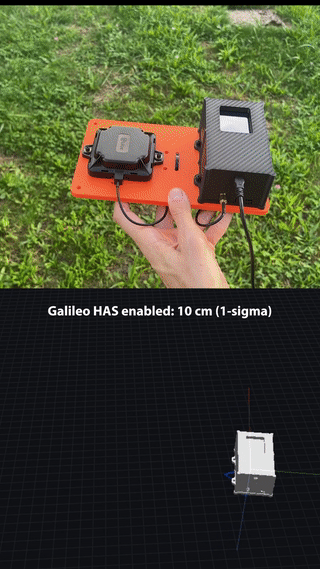

<!-- COVERAGE:START -->
**Test coverage** of the core library (`src/`):

| Metric | Coverage |
|---|---|
| C0 (Line) | 99.4% (4413/4439) |
| C1 (Branch) | 92.1% (2935/3187) |
| MC/DC | 92.0% (2908/3162) |
<!-- COVERAGE:END -->

<!-- STACK:START -->
**Worst-case stack usage** in bytes, deepest call chain including KFCore and the C library, from static analysis (`make stack`):

| Entry point | x86_64-linux-gnu, GCC 14.2.0 |
|---|---:|
| `nav_suite_update()` | 13264 |
| `ins_update()` | 11856 |
| `ahrs_update()` | 8240 |
| `baro_alt_update()` | 7904 |
| `nav_suite_init()` | 2672 |
| `ins_init()` | 2656 |
<!-- STACK:END -->

## Example Video


*Example video of pure inertial tracking with a TDK ICM-45686 low-cost Inertial Measurement Unit (IMU)*

## Overview

INSLIB is a portable C library for 3D navigation state estimation.  Its core is
a set of Kalman filters fusing measurements from an inertial measurement unit
(IMU) with GNSS/GPS measurements, barometer, magnetometer, local position
references, absolute yaw references (GNSS compassing), scalar ground speed
(wheel thicks) and zero-velocity / zero-rotation information.

**Typical use cases:**
* Drones (UAVs) and autonomous vehicles
* Robotics platforms
* Aerospace
* Cars
* Embedded systems requiring precise tracking
* Post-processing of recorded flights or driving data

The core library is written in pure **C** (C11), has no external dependencies
and is optimized for embedded microcontrollers.  A useful collection of Python
helper programs and GUI apps are included in this repository.
The Python binding is on PyPI: `pip install inslib` (see the
[Python tutorial](tutorial/python_tutorial.md)).

## Features

* `>90% Test Coverage` including **MC/DC** testing (also used in aerospace **DO-178 DAL-A** or **ISO26262 ASIL-D** developments)
* **Requirements traceability**: code logic is linked to a machine-checked [requirements database](requirements/) (`make reqs`), aerospace-style
* Battle tested heavily with real world data and edge cases
* Measurement delay compensation and estimation (e.g. GNSS/GPS receivers typically have more than 100-200 milliseconds of latency due to processing, internal filtering, UART transmission, etc.)
* Suited for UAVs: during a GNSS outage the filter keeps providing an inertial-fused altitude (via the parallel `baro_alt` vertical channel) and full attitude, not just raw IMU integration
* Excellent performance compared to similar libraries, see [benchmark](#inslib-benchmark-and-validation) below
* UAVs that only need roll/pitch, no yaw/heading, can skip the magnetometer entirely: the standalone `AHRS_MODE_ARS` mode (5-state, gyro compass yaw) runs from IMU data alone
* Robust UDU/Bierman-Thornton Kalman Filter routines for numerically robust square-root filtering (effective precision for covariance is increased)
* Worst-Case-Execution Time (WCET) friendly: no unbounded loops, recursion, suitable for real-time control loops
* **Known stack usage**: static worst-case stack analysis of every public API function (`make stack`, using GCC's `-fcallgraph-info`)
* Static code analysis tests (incl. undefined behaviour sanitizer **UBSan**, address sanitizer **ASan**)
* Built-in light-weight World Magnetic Model (WMM) for magnetometer declination compensation
* No heap, no OS dependencies, portable code: runs on bare-metal **embedded** targets as well as on a desktop computer
* 32-bit float (IEEE 754) for most calculations (except for GNSS/GPS coordinates), no 64-bit double precision hardware floating point unit (FPU) required
* Calibration tools included to calibrate sensor bias, scale, and misalignment without expensive calibration hardware (Tedaldi et al., ICRA 2014)


## Post Processing Quickstart


`inspostgui.py` is a GUI to post-process measurements: open a dataset's config
YAML (contains filter settings and points to the `.csv` files), tweak its
settings, and replay it. A forward-/backward smoothing can be done in post-processing
to improve the solution quality ("RTS smoother").

**Windows, no Python needed:** download `inspostgui-<version>-windows-x64.zip` from the
[latest release](https://github.com/jnz/INSLIB/releases/latest), unzip it (keep the folder
together) and start `inspostgui.exe`. Windows may show a SmartScreen warning, the
code is not signed. Otherwise run the Python source directly:

```sh
sh python/setup_venv.sh               # one-time (also runs `make pylib`)
. env.sh                              # activate the venv (POSIX/git-bash, any OS)
python3 tools/inspostgui.py datasets/fog
```

### `.csv` Data Format

The input format is plain CSV, one file per sensor. First item is a common
`t_us` timestamp in microseconds. IMU (gyroscope and accelerometer) example in
the Front/Right/Down (FRD) body coordinate system:

```text
# t_us, gyr_frd_x[rad/s], gyr_frd_y[rad/s], gyr_frd_z[rad/s], acc_frd_x[m/s^2], acc_frd_y[m/s^2], acc_frd_z[m/s^2]
0,      -0.0016,          0.0000,           -0.0003,          -0.1149,          0.1915,           -9.8450
5000,   -0.0014,          0.0020,           -0.0001,          -0.1231,          0.2316,           -9.8221
10000,  -0.0003,         -0.0003,            0.0008,          -0.0862,          0.2490,           -9.7588
```


GNSS/magnetometer/barometer/speed `.csv` files follow the same pattern. Example files:

* [IMU example](doc/example_imu.csv)
* [Barometer example](datasets/crazyflie/dead_reckoning/baro.csv)
* [GNSS example](doc/example_gnss.csv) (position/velocity with full NED
  covariance, plus the optional fix quality in RTKLIB numbering and the
  receiver's GPS week/time of week)
* [Time sync example](doc/example_timesync.csv) (optional `timesync.csv`:
  map timestamps `t_us` to GPS time and UTC host computer time, see [documentation](tools/inslib_protocol.md#0x40--0x05-time-sync))
* [Magnetometer example](datasets/pedestrian/07_outdoor_only/mag.csv)
* [Wheel speed (odometry) example](datasets/tunnel_odometry/speed.csv)

### `config.yaml`

A dataset directory with CSV files contains a configuration file
(`config.yaml`) that tells the filter how to run, which modes are active,
tuning settings and options. Two examples to start from:
[doc/example_conf/config_basic.yaml](doc/example_conf/config_basic.yaml)
(GNSS+IMU+baro+mag) and
[doc/example_conf/config_local_inertial.yaml](doc/example_conf/config_local_inertial.yaml)
(GNSS-free, pure inertial dead-reckoning). The keys are documented in
[doc/INSLIB_manual.pdf](doc/INSLIB_manual.pdf), section "Dataset
configuration: config.yaml".

### `replay.py` Command Line Post-Processing Version

`replay.py` is the command line (CLI) version of the `inspostgui.py` Python GUI above.

```sh
sh python/setup_venv.sh               # one-time (also runs `make pylib`)
. env.sh                              # activate the venv (POSIX/git-bash, any OS)
python3 tools/replay.py datasets/fog --plot --plot-out /tmp/plots.pdf
```

Example PDF plot output from `replay.py`:

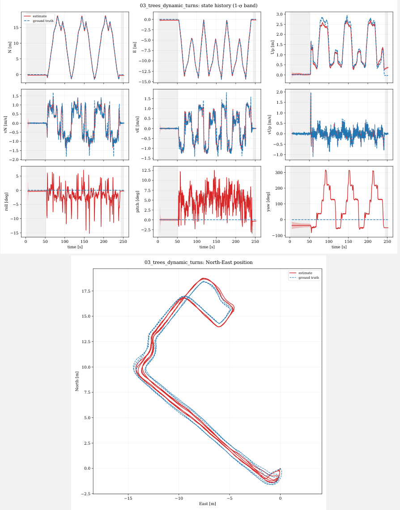

Google Earth `.kml` output is also possible with `--kml output.kml`.

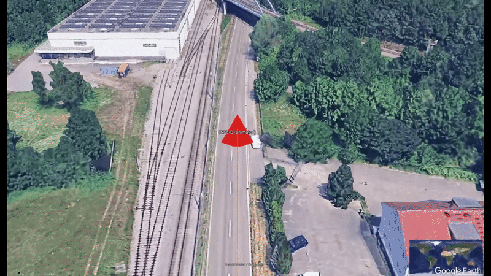

## GNSS Latency Estimation

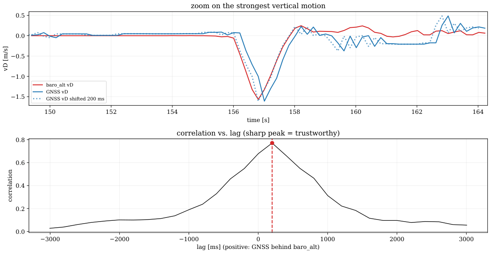

GNSS receivers report data with some latency
(transmission, internal processing, filtering) but
this is receiver and configuration dependent. `inspostgui.py` and `replay.py` measure
the real value for a specific configuration: IMU + barometric altitude has near-zero
latency, cross-correlating its vertical velocity against the
GNSS-reported vertical velocity around a real climb/descent results in a lag
with a sharp correlation peak (see the plot above).

Example for a u-blox X20P receiver delay estimation:
```sh
python3 tools/replay.py datasets/pedestrian/07_outdoor_only/ --estimate-gnss-delay
```

## Live Data Quickstart

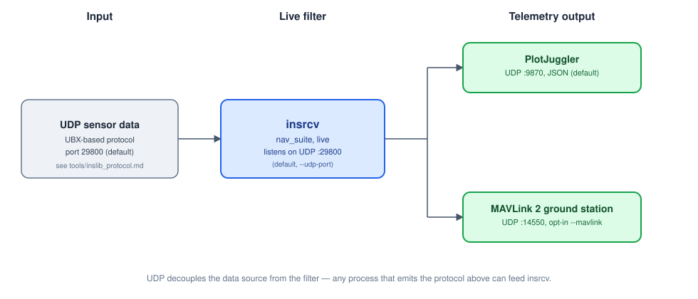

`insrcv` listens for UDP packets with sensor measurements. This custom packet
format (extending the UBX format) is documented in
[tools/inslib_protocol.md](tools/inslib_protocol.md).  Any process that sends
this protocol format can feed it on UDP port `29800` (default). Output goes to
PlotJuggler (UDP `:9870`, JSON) and optionally in MAVLink format (UDP `:14550`).

```sh
make insrcv
./build/insrcv --mavlink   # run and wait for UDP sensor input
```

## Tutorials

* [tutorial/c_tutorial.md](tutorial/c_tutorial.md): use the library from **C/C++**: a full example
* [tutorial/c_attitude_tutorial.md](tutorial/c_attitude_tutorial.md): roll and pitch from gyroscope and accelerometer only (no GNSS, magnetometer or barometer), with the minimal list of source files to copy
* [tutorial/python_tutorial.md](tutorial/python_tutorial.md): the filter from Python in a few lines, including installation
* [doc/INSLIB_manual.pdf](doc/INSLIB_manual.pdf): documentation, including filter design and math background

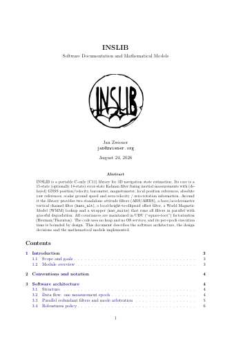

## GNSS inputs

* Standard single point positioning with pseudoranges (and optionally SBAS corrections)
* Galileo High Accuracy Service (HAS) support from e.g. u-blox X20-series for `<10 cm` horizontal accuracy (1-sigma) without a correction service (requires compatible antenna)
* u-blox SPARTN/PointPerfect Flex (commercial) correction stream supported for `3-6 cm` accuracy and convergence in seconds (source: [u-blox](https://www.u-blox.com/en/product/pointperfectflex))
* RTK via NTRIP RTCM corrections for `~1 cm` accuracy, from your own GNSS base station, a virtual base station, or a regional service such as SAPOS

## Supported sensors

* Inertial Measurement Units (IMU): Accelerometer, Gyroscope
* GNSS/GPS Receivers (e.g. u-blox X20, F9P, etc.)
* GNSS Dual Antenna Compass Systems
* Magnetometers
* Barometers
* Local motion capture systems (mocap, like Lighthouse)
* OBDII Odometry Reader (wheel speed)
* Virtual zero velocity (ZUPT), zero rotation rate (ZARU) sensors

## Real world data sets

* [UAV data](datasets/crazyflie): Crazyflie 2.1 Brushless UAV with accurate ground truth from Lighthouse mocap system
* [Rotorcraft](datasets/fog): MEMS vs. FOG (Fiber Optic Gyro reference) INS comparision while airborne in a rotorcraft
* [Car](datasets/tunnel): data with e.g. GNSS outages from a road tunnel or degraded satellite visibility in urban canyons
* [Car with wheel speed](datasets/tunnel_odometry): a road tunnel GNSS outage bridged with OBD2 odometry
* [Pedestrian](datasets/pedestrian): Handheld walking trials
* [ArduPilot](datasets/pedestrian/06_outdoor_to_indoor): comparison with ArduPilot EKF3 solution from the same measurements
* [kfgins](datasets/kfgins): comparison with navigation solution library from Wuhan University (i2Nav group)
* [Paul Groves book](datasets/simulated/profile_1_car): comparison with solution from Paul Groves book MATLAB example code
* [MATLAB Navigation Toolbox](datasets/simulated/B_drone): comparison with solution from MATLAB's Navigation Toolbox

*(Not all datasets have an absolute ground truth available, e.g. the ArduPilot dataset is comparing the INSLIB solution with the ArduPilot solution)*

### INSLIB benchmark and validation

The measurements of the [KF-GINS](https://github.com/i2Nav-WHU/KF-GINS)
authors
([awesome-gins-datasets](https://github.com/i2Nav-WHU/awesome-gins-datasets))
with five different IMUs and a ground truth is used.

| IMU         | Description             | Vendor              | Gyro Bias Instability [°/h] |
| ----------- | ----------------------- | ------------------- | ----- |
| ICM20602    | consumer-grade chip     | TDK / InvenSense    | 10.0  |
| ADIS16460   | industrial-grade module | Analog Devices      | 8.0   |
| ADIS16465   | industrial-grade module | Analog Devices      | 2.0   |
| HGuide-i300 | industrial-grade module | Honeywell           | 3.0   |
| Leador A15  | navigation-grade FOG IMU | Leador             | 0.03  |

The car trajectory with those five IMUs and RTK-GNSS
positions and a ground truth, processed by INSLIB and by KF-GINS
(commit `8291a93`) are compared.

Error RMS vs. ground truth: INSLIB / KF-GINS (smaller is better):

| IMU | Horizontal [m] (INSLIB / KF-GINS) | Vertical [m] (INSLIB / KF-GINS) | Roll [°] (INSLIB / KF-GINS) | Pitch [°] (INSLIB / KF-GINS) | Yaw [°] (INSLIB / KF-GINS) |
| :--- | :---: | :---: | :---: | :---: | :---: |
| **ICM20602** | 0.019m / 0.020m | 0.063m / 0.058m | 0.024° / 0.032° | 0.025° / 0.026° | 0.179° / 0.182° |
| **ADIS16460** | 0.021m / 0.031m | 0.029m / 0.031m | 0.027° / 0.046° | 0.051° / 0.099° | 0.219° / 0.241° |
| **ADIS16465** | 0.017m / 0.017m | 0.024m / 0.026m | 0.014° / 0.014° | 0.015° / 0.013° | 0.106° / 0.089° |
| **i300** | 0.016m / 0.017m | 0.030m / 0.028m | 0.012° / 0.011° | 0.012° / 0.011° | 0.068° / 0.070° |
| **Leador A15** | 0.009m / 0.012m | 0.009m / 0.009m | 0.001° / 0.001° | 0.001° / 0.001° | 0.016° / 0.018° |

Results from INSLIB v1.3.0. The Leador A15 dataset is part of this repository
([datasets/kfgins](datasets/kfgins)). The other trials are not in the repo, but
the INSLIB `config.yaml` and the respective KF-GINS `kf-gins.yaml` are in the
subdirectories of [datasets/kfgins](datasets/kfgins) for replication.

### INSLIB and ArduPilot EKF3

To also test EKF3 from ArduPilot, the same [awesome-gins-datasets](https://github.com/i2Nav-WHU/awesome-gins-datasets)
are used but with a synthetic GNSS velocity added (ArduPilot's EKF3 requires a GNSS velocity to work).
EKF3 is ArduPilot `4.8.0-dev` (`6fb4ba5185`) through its log replay tool, configured as ground vehicle with the Rover
parameters, with GPS height and velocity and no magnetometer. Yaw source is none (`EK3_SRC1_YAW=0`), the EKF3 GSF yaw
estimator submodule is used to align yaw in EKF3.

Error RMS vs. ground truth, horizontal [m] / yaw [°], smaller is better:

| IMU | INSLIB | KF-GINS | ArduPilot EKF3 |
|---|---|---|---|
| ICM20602 | 0.019m / 0.177° | 0.020m / 0.182° | 0.078m / 0.951° |
| ADIS16460 | 0.021m / 0.220° | 0.031m / 0.241° | 0.064m / 0.305° |
| ADIS16465 | 0.017m / 0.106° | 0.017m / 0.089° | 0.066m / 0.788° |
| i300 | 0.016m / 0.068° | 0.017m / 0.070° | 0.067m / 0.232° |
| Leador A15 (FOG) | 0.009m / 0.016° | 0.012m / 0.018° | 0.060m / 0.148° |

Roll / pitch error RMS [°] of the same runs (smaller is better):

| IMU | INSLIB | KF-GINS | ArduPilot EKF3 |
|---|---|---|---|
| ICM20602 | 0.024° / 0.025° | 0.032° / 0.026° | 0.073° / 0.082° |
| ADIS16460 | 0.027° / 0.050° | 0.046° / 0.099° | 0.049° / 0.055° |
| ADIS16465 | 0.014° / 0.016° | 0.014° / 0.013° | 0.055° / 0.068° |
| i300 | 0.012° / 0.012° | 0.011° / 0.011° | 0.056° / 0.034° |
| Leador A15 (FOG) | 0.001° / 0.001° | 0.001° / 0.001° | 0.078° / 0.048° |

With simulated GNSS outages of 60 s every 300 s. 3D position error when GNSS
returns, mean / max over the outages (smaller is better):

| IMU | INSLIB | INSLIB + NHC¹ | KF-GINS | ArduPilot EKF3 |
|---|---|---|---|---|
| ICM20602 | 56.9m / 152m | 9.9m / 16.4m | 55.2m / 149m | 69.5m / 156m |
| ADIS16460 | 12.2m / 25.1m | 6.4m / 16.0m | 18.6m / 27.5m | 14.5m / 23.2m |
| ADIS16465 | 8.5m / 13.3m | 3.2m / 5.7m | 8.0m / 14.1m | 11.4m / 28.9m |
| i300 | 5.5m / 6.6m | 3.6m / 4.3m | 4.4m / 7.3m | 11.7m / 21.1m |
| Leador A15 | 0.70m / 1.11m | 1.46m / 7.16m | 0.58m / 0.87m | 15.6m / 39.2m |

¹ Enabled non-holonomic (NHC) automotive lateral constraint (`automotive_lateral_constraint`).

### INSLIB with faulty GNSS measurements

The following comparison is injecting faults
into GNSS measurements: one fault type per run, the same errors are applied for every filter.
INSLIB runs with its default outlier handling (chi2 on) and for
comparison without it. KF-GINS fuses every fix, EKF3 has its innovation
gates and GPS glitch reset.

The runs are the five car trials from above (all five IMUs).
Mean error over all events of all five IMUs / median time until
the error stays below 0.3 m again (smaller is better):

| Fault | INSLIB | INSLIB, no outlier test | KF-GINS | EKF3 |
|---|---|---|---|---|
| `spike`: single fixes 5 to 50 m off | 0.068m / 0.0s | 38.9m / 21.0s | 29.7m / > 30s | 0.726m / 1.1s |
| `multipath`: 3 to 15 m for 5 to 30 s, 1 m reported | 1.94m / 7.0s | 4.81m / 9.0s | 6.79m / 1.0s | 11.0m / 21.1s |
| `degraded`: 1 m noise for 30 s, honestly reported | 0.688m / 4.0s | 0.688m / 4.0s | 0.940m / 1.0s | 1.67m / 3.7s |
| `gross`: 2 or 3 single fixes 500 m off within 30 s | 0.071m / 0.0s | 534m / > 30s | 493m / > 30s | 9.48m / 0.0s |

## Setup

This repository uses the `KFCore` git submodule. Clone it recursively:

```sh
git clone --recursive <repo-url>
```

If you already cloned without `--recursive`, fetch the submodule with:

```sh
git submodule update --init --recursive
```

The core C library only needs a C11 compiler and `make` (see Quickstart
above). The Python bindings, plotting and reference-board tools additionally
need a virtual environment:

```sh
sh python/setup_venv.sh      # one-time (Windows: python\setup_venv.bat)
. env.sh                     # activate the venv (POSIX/git-bash, any OS)
```

`make check-all` (see `coding_style.md`) additionally wants `clang-format`,
`cppcheck`, `clang-tidy`, `lcov` and `doxygen`.

## Integration: Required Source Files

INSLIB has no build system requirement. Just add the files you need
to your project. All files are portable without dependencies.

Which variant do I need?

| Variant | What it does | Inputs | Outputs | Pick it if |
|---|---|---|---|---|
| **ARS** (`ahrs.c`, `AHRS_MODE_ARS`) | 5-state roll/pitch filter. Yaw is only integrated from the gyro and drifts (directional gyro) | IMU | roll, pitch, free-running yaw, gyro bias | You only need the horizon (e.g. stabilization), no absolute heading, no magnetometer |
| **AHRS** (`ahrs.c`, `AHRS_MODE_AHRS`) | 6-state roll/pitch/yaw filter, yaw stabilized by the magnetometer (true north via the built-in WMM once a position is given) | IMU, magnetometer | roll, pitch, yaw, gyro bias | You need a drift-free heading but no position or velocity |
| **INS** (`ins.c`) | Full 15-state error-state Kalman filter (18 with magnetometer hard-iron bias) | IMU plus any of GNSS, magnetometer, barometer, local position, GNSS compass, ground speed | position, velocity, attitude, sensor biases | You need a 3D navigation solution |
| **baro_alt** (`baro_alt.c`) | 3-state barometer/accelerometer vertical filter (height, vertical velocity, accel correction), plus a 1-state baro/GNSS height offset filter | accelerometer, barometer, attitude from any source | smooth height, vertical velocity | You only need a good altitude and climb rate, or want it to keep working during a GNSS outage |
| **nav_suite** (`nav_suite.c`) | Wrapper running INS, ARS, AHRS and baro_alt in parallel from one measurement stream. Arbitrates the best attitude and height source and aligns the vertical datum | everything above | everything above, always the best available one | You want the full system and no manual glue code |

| File | Full suite | INS only | ARS only | AHRS | `baro_alt` only |
|---|:-:|:-:|:-:|:-:|:-:|
| `src/nav_suite.c/.h` | x | | | | |
| `src/ins.c/.h` | x | x | | | |
| `src/ahrs.c/.h` | x | | x | x | |
| `src/baro_alt.c/.h` | x | | | | x |
| `src/magnetic_model.c/.h` | x | x | | x | |
| `src/wmm_lut.h` | x | x | | x | |
| `src/geodetic_toolbox.c/.h` | x | x | x | x | x |
| `src/sensor_defaults.h` | x | x | x | x | x |
| `KFCore/c/kalman_udu.c/.h` | x | x | x | x | x |
| `KFCore/c/linalg.c/.h` | x | x | x | x | x |
| `KFCore/c/miniblas.c/.h` | x | x | x | x | x |
| `src/log.c/.h` | x | x | x | x | x |

Notes:

* Main header per module: `nav_suite.h`, `ins.h`, `ahrs.h`, `baro_alt.h`.
* ARS and AHRS share `ahrs.c` (mode set via `ahrs_config_t.mode`). Building it
  with `-DAHRS_NO_MAG` gives an ARS-only filter that does not need
  `magnetic_model.c/.h` and `wmm_lut.h`.
* `wmm_test_vectors.h` is only used by the tests.
* Logging is optional. Compile with `-DLOG_LEVEL=LOG_LEVEL_NONE` and all
  log calls expand to nothing, so `log.c` does not need to be linked (keep
  `log.h`, the sources still include it). Otherwise the default sink prints to
  stdout via `vprintf()`, redirect it on embedded targets with `log_set_sink()`.

## Directory Structure

```text
📂 inslib/
├── Makefile              # Build: make test, make insrcv, ...
├── src/                  # Core library (.c/.h)
│   └── nav_suite.h       # Main header: INS + AHRS + baro_alt wrapper
├── KFCore/               # Submodule: linear algebra, Kalman UDU filter
├── tests/                # Unit/integration tests
├── datasets/             # Real-world + simulated replay datasets
├── tools/                # Command line programs: insrcv, replay (C and Python), post-processing GUI, calibration, receiver setup, protocol
├── python/               # Python package INSLIB (ctypes binding) and its tests
├── magneticmodel/        # WMM lookup table
├── doc/                  # Documentation, Doxygen, images
└── tutorial/             # Minimal C + Python usage examples
```

## Library Architecture Block Diagram

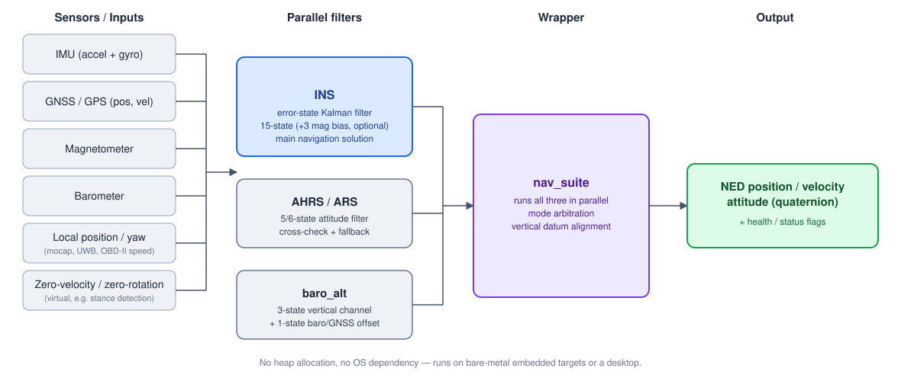


## Reference Hardware

The live receiver `insrcv` (`tools/`) speaks an open (UBX-based) protocol,
documented in [tools/inslib_protocol.md](tools/inslib_protocol.md).

The *reference board* is a low-cost and ready-to-use development module (IMU,
u-blox GNSS receiver, magnetometer, barometer) for running INSLIB on real
hardware with pre-calibrated sensors.  It implements the protocol above and is
ready to use out of the box. Its firmware and the host tools that come with it
(serial hub, control GUI, configuration, calibration window) are not public, get in touch if
you're interested in a collaboration with my university institute or in getting a unit.

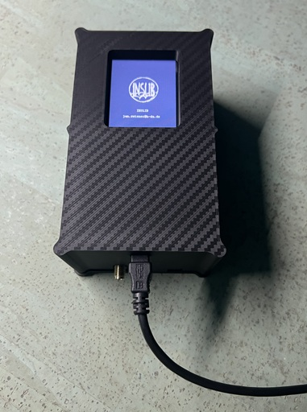

Building your own sensor suite is also possible, an example conf (2026/2027 sensor landscape):

| Sensor | Example part | Notes |
|---|---|---|
| IMU | TDK InvenSense ICM-45686, Bosch BMI563/BMI570, Analog Devices ADIS16505 or Murata SCH16T-K10 | |
| Magnetometer | MEMSIC MMC5603NJ or ST LIS3MDL | |
| Barometer | Bosch BMP581 or TE MS5611 | |
| GNSS receiver | u-blox F9P or X20 | X20-series has L1/L2/L5 support and Galileo HAS decoding |

### Reference Board Calibration GUI

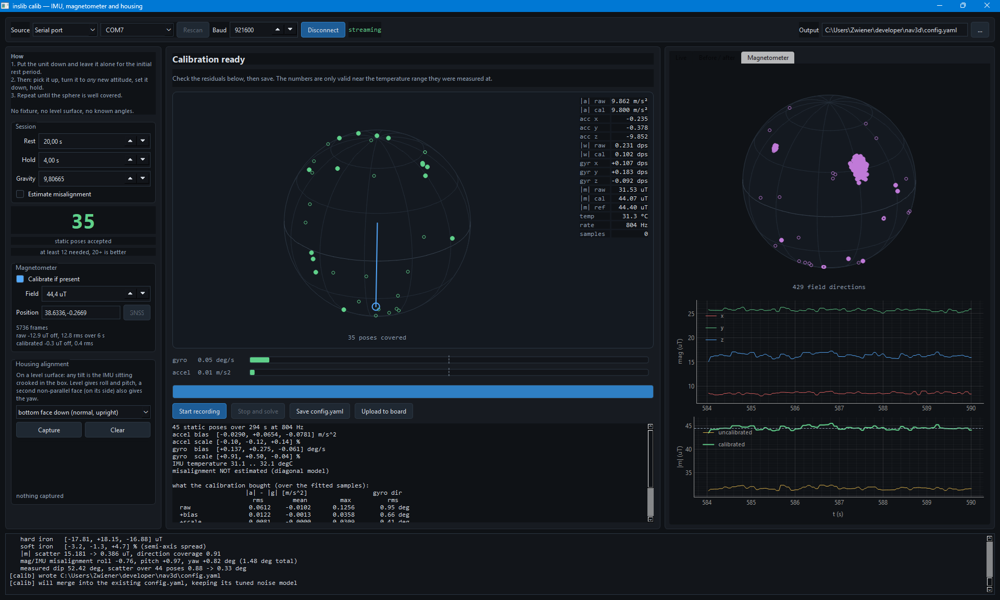

IMU/Magnetometer-Calibration + Housing-Alignment, user-friendly GUI for the
reference board.  The GUI allows an easy calibration of the sensor hardware for
bias, scale and misalignment **without** the need for an expensive calibration
environment like robotic arms, except for a controlled temperature environment.
The sensor must be placed still for a few seconds in a variety of different orientations on a stable
surface:

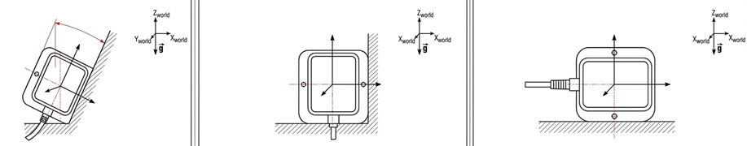

### Sensor Management GUI

Live-Control center for reference INS board

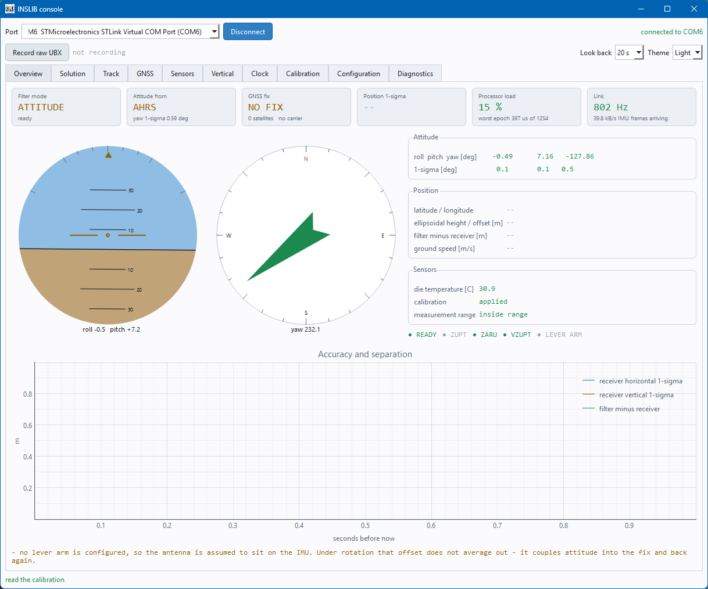

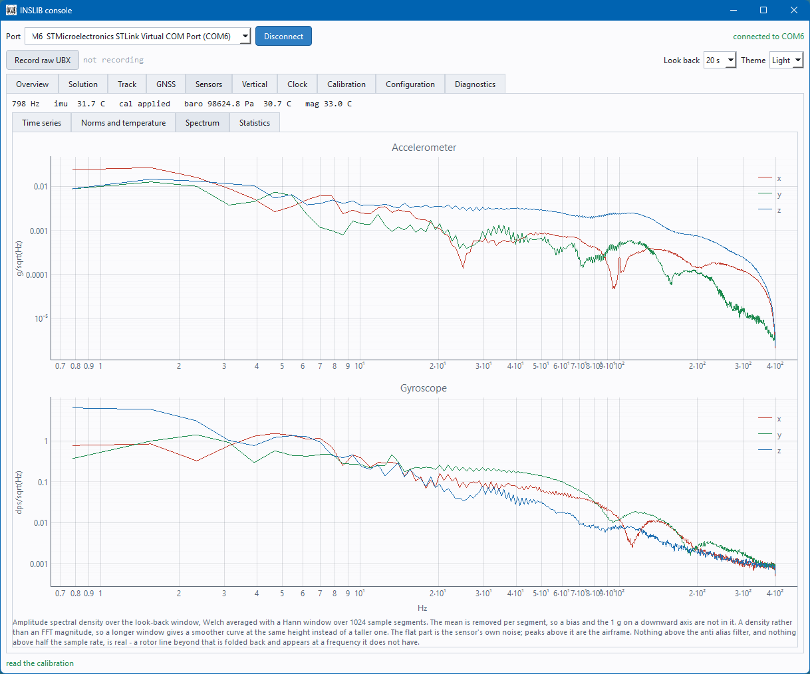

### Command Line Tools

* [`insrcv`](tools/insrcv.c) Live receiver: UDP stream in, navigation solution out (PlotJuggler, MAVLink)
* [`tools/replay.py`](tools/replay.py) and [`tools/inspostgui.py`](tools/inspostgui.py) Replay a dataset through the filter, plots and GUI
* [`tools/inslib_imu_calib.py`](tools/inslib_imu_calib.py) Command line IMU-calibration tool (offline from any IMU's `.csv` log with `--csv`)
* [`tools/allan_variance.py`](tools/allan_variance.py) Allan variance: noise and bias random walk from a static recording
* [`tools/ublox_f9p_config.py`](tools/ublox_f9p_config.py), [`tools/ublox_x20p_config.py`](tools/ublox_x20p_config.py) Persistent u-blox receiver configuration

## Common Pitfalls

IMU sensor processing is unforgiving: it is not enough to get one thing
right, the whole chain (timestamps, axis conventions, calibration,
filtering, etc.) has to line up properly. A list of common mistakes:

* **Magnetometer not calibrated** (the classic). Uncorrected hard-/soft-iron
  bias means wrong yaw, use the [calibration
  GUI](#reference-board-calibration-gui) or the command line tool
  `inslib_imu_calib.py` with `.csv` data.
* **IMU and magnetometer axes not in body frame**: INSLIB expects one
  consistent FRD body frame (x = front, y = right, z = down) for every sensor
  (see [coding_style.md](coding_style.md)), mismatched coordinate frames will
  produce nonsense outputs.
* **Accelerometer/gyroscope PSD and bias random walk not measured on the target
  sensor and environment** (classic as well): either not measured at all
  (random defaults), or measured in a non-representative setting (e.g. an cozy
  office room, without the real vibration/thermal environment) - both make the
  filter over- or under-confident in the IMU.
* **GNSS reception too poor** INSLIB expects good GNSS data. Indoors or under
  heavy multipath, the library auto-init will reject the GNSS data. A
  high-quality GNSS receiver with a matching high-quality antenna is a must.
  Smartphone GNSS antennas are typically not good enough.
* **GNSS receiver not configured** There are countless ways to misconfigure
  a GNSS receiver. A working configuration for u-blox F9P and X20 receivers
  can be found [here (F9P)](tools/ublox_f9p_config.py) and [here (X20)](tools/ublox_x20p_config.py).
* **Timestamps not synchronized or not monotonic** every sensor needs to be
  aligned to a single monotonic timebase (`t_us`). Clock issues break the
  library.
* **GNSS latency not measured**: a guessed `gnss: delay_ms` biases position
  during dynamic motion, see [GNSS Latency Estimation](#gnss-latency-estimation).
  Even with a correct timestamp the GNSS solution is typically lagging
  behind due to internal filtering.
* **GNSS antenna lever arm not set**: the offset between IMU and GNSS antenna
  (`gnss: leverarm_frd`) has an impact on position and attitude,
  especially during dynamic turns.
* **IMU calibrated on a magnetic surface**: the [calibration
  GUI](#reference-board-calibration-gui) fits the magnetometer from the same
  session of static poses as the IMU, not a separate one.
  A metal-legged table, or a nearby laptop biases the field it reads -
  a genuinely non-magnetic and stable calibration environment is harder to find
  than it sounds. For a UAV this does not apply: calibrate the
  magnetometer already mounted in the airframe, at its final position.
* **Unexpected height source with GNSS + barometer**: with both connected, the
  filter prefers the barometer for height by default (it keeps
  working through a GNSS outage). Set `baro_height_disable: 1` in
  `config.yaml` to force GNSS/local-position height instead.
* **No anti-aliasing/low-pass filtering on a vibrating IMU**: rotor or engine
  vibration aliases into the accelerometer/gyroscope band and breaks the noise
  model and introduce ghost accelerations. Must be filtered out before the data
  reaches INSLIB. The library cannot fix aliasing problems.
* **Sensor data over-filtered**: heavy internal/firmware smoothing adds
  its own latency.
* **IMU not calibrated over its operating temperature range**: bias/scale
  drift with temperature directly leaks into the solution. Generally
  the sensor should be in a temperature stable environment.
* **Weak sensors**: not every low-cost sensor is good enough.
* **Insufficient motion excitation for yaw observability** without turns
  (or magnetometer/GNSS-compass aiding), heading might not be reliable.

## AI Use

* The core library (`src/`) and the `KFCore` library is designed and written by a human with 20 years of experience in this field
* This `README.md` is written by a human
* The realworld datasets are collected, analyzed and tested by a human
* The code is extended and improved by Claude Opus and Sonnet, doxygen comments are improved and added
* Code and comments written by Claude are reviewed by a human (no auto-commit)
* `insrcv` is largely written by Claude
* Unit tests, the build system and the Python GUI tools are basically written 100% by Claude

## References

* J. Wendel, *Integrierte Navigationssysteme: Sensordatenfusion, GPS und Inertiale Navigation*, 2nd ed., Oldenbourg, 2011.
* D. H. Titterton and J. L. Weston, *Strapdown Inertial Navigation Technology*, 2nd ed., IET, 2004.
* G. J. Bierman, *Factorization Methods for Discrete Sequential Estimation*, Academic Press, 1977.
* M. S. Grewal and A. P. Andrews, *Kalman Filtering: Theory and Practice Using MATLAB*, 4th ed., Wiley, 2015.
* G. Chang, "Robust Kalman filtering based on Mahalanobis distance as outlier judging criterion," *Journal of Geodesy*, vol. 88, no. 4, pp. 391-401, 2014.
* P. D. Groves, *Principles of GNSS, Inertial, and Multisensor Integrated Navigation Systems*, 2nd ed., Artech House, 2013.
* J. R. Carpenter and C. N. D'Souza, *Navigation Filter Best Practices*, NASA/TP-2018-219822, NF1676L-29886, 2018. [PDF](https://ntrs.nasa.gov/api/citations/20180003657/downloads/20180003657.pdf)
* J. Zwiener, *Robuste Zustandsschätzung zur Navigation und Regelung autonomer und bemannter Multikopter mit verteilten Sensoren*, Schriftenreihe der Fachrichtung Geodäsie, Fachbereich Bau- und Umweltingenieurwissenschaften, Technische Universität Darmstadt, ISBN 978-3-935631-43-3, Heft 54, Darmstadt, 2019.

## Citation

If you use INSLIB in academic work, please cite it (see [`CITATION.cff`](CITATION.cff),
also picked up by GitHub's "Cite this repository" button):

```bibtex
@software{zwiener_inslib,
  author = {Zwiener, Jan},
  title  = {{INSLIB: A Portable C Library for 3D Navigation State Estimation}},
  url    = {https://github.com/jnz/INSLIB},
  year   = {2026}
}
```
