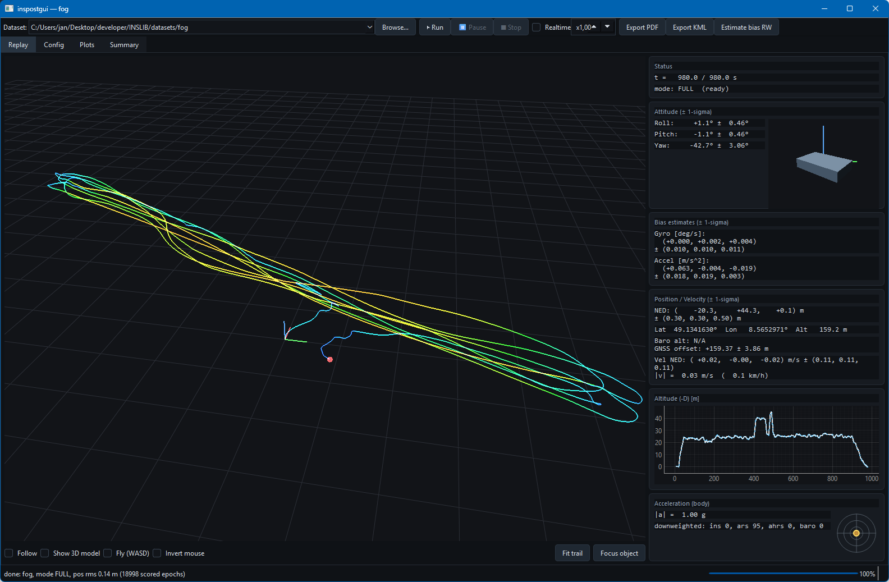

# INSLIB in Python

The navigation filter of the INSLIB C library, as a Python package.
Install, feed sensor samples, read the result.
This tutorial shows how to do it.

## Install

```sh
pip install inslib
```

Installation is simple, a prebuilt package with the compiled INSLIB functions
inside. No compiler needed for Linux (including the Raspberry Pi), Windows and
macOS, Python 3.8 or newer. The import name is `INSLIB`:

```sh
python3 -c "import INSLIB; print(INSLIB.__version__)"
```

## Roll and pitch in a few lines

The smallest useful setup needs a gyroscope and an accelerometer:
roll and pitch, for a tilt sensor, a balancing robot or a gimbal. The
attitude filter that does this, the ARS (attitude reference system), runs
inside every `Navigator`, so the IMU data is all you feed it:

```python
import math
import random
from INSLIB import Navigator

D2R = math.pi / 180.0

# Stand-in for a real sensor: an IMU resting at roll 10 deg, pitch -5 deg.
# Body frame FRD (front/right/down),
# accelerometer (acc) in m/s^2 (lying flat would read 0, 0, -9.81),
# gyroscope (gyr) in rad/s.
# A little noise is added here, like a real sensor.
def read_imu():
    r, p, g = 10.0 * D2R, -5.0 * D2R, 9.81
    acc = (g * math.sin(p), -g * math.sin(r) * math.cos(p),
           -g * math.cos(r) * math.cos(p))
    acc = [a + random.gauss(0.0, 0.02) for a in acc]
    gyr = [random.gauss(0.0, 0.002) for _ in range(3)]
    return acc, gyr

random.seed(1)
nav = Navigator()

dt = 0.01                                  # 100 Hz simulated data
for k in range(1, 501):                    # Simulate for 5 s
    acc, gyr = read_imu()
    nav.imu(int(k * dt * 1e6), dt, acc=acc, gyr=gyr)
    nav.update()                           # Process data
    rpy = nav.rpy_ars()                    # Get [roll, pitch, yaw] in rad
    if rpy:
        if k % 100 == 0:
            print("t %.0f s  roll %6.2f deg  pitch %6.2f deg"
                  % (k * dt, rpy[0] / D2R, rpy[1] / D2R))
```

It prints:

```
t 1 s  roll   9.97 deg  pitch  -4.98 deg
t 2 s  roll  10.00 deg  pitch  -5.01 deg
t 3 s  roll  10.03 deg  pitch  -5.02 deg
t 4 s  roll  10.03 deg  pitch  -5.00 deg
t 5 s  roll  10.04 deg  pitch  -4.99 deg
```

For your own sensor, replace `read_imu()` and use its real time stamps
(`t_us`, microseconds) and sample interval `dt`. The gyro bias is
estimated along the way. The yaw is not north referenced: without a
magnetometer it is just the integrated z gyro and drifts.

## Adding GNSS: position and velocity

Add a GNSS receiver and the same `Navigator` gives you position, velocity
and a full attitude. Here a stationary IMU at 100 Hz with a once-per-second
fix:

```python
import math
from INSLIB import Navigator, Config

D2R = math.pi / 180.0

# The (stationary) location: a spot in Darmstadt, 190 m ellipsoidal.
lat, lon, h = 49.867378 * D2R, 8.638174 * D2R, 190.0

nav = Navigator(Config(auto_init=True))

dt = 0.01                                  # 100 Hz
for k in range(1, 1201):                   # 12 s: the 3D entry dwell is 5 s
    t_us = int(k * dt * 1e6)
    nav.imu(t_us, dt, acc=(0.0, 0.0, -9.81), gyr=(0.0, 0.0, 0.0))
    if k % 100 == 0:                       # a 1 Hz GNSS fix
        # As the receiver reports it. 2 m stddev per axis -> variance 4.
        # The vertical one has to stay inside the 3D entry gate (3 m),
        # otherwise the filter keeps the solution at ATTITUDE_ONLY.
        nav.gnss_pos_llh((lat, lon, h), var_ned=(4.0, 4.0, 4.0))
    nav.update()                           # run the filter for this epoch
    sol = nav.solution()                   # read the result back

print("mode:", sol.mode, " ready:", sol.ready)
print("lat %.6f deg  lon %.6f deg  h %.1f m"
      % (sol.lat_rad / D2R, sol.lon_rad / D2R, sol.alt_m))
print("rpy  %.2f  %.2f  %.2f deg"
      % (sol.roll / D2R, sol.pitch / D2R, sol.yaw / D2R))
```

Expected output:

```
mode: FULL  ready: True
lat 49.867378 deg  lon 8.638174 deg  h 190.0 m
rpy  -0.00  0.00  0.00 deg
```

`sol.mode` tells you how good the answer is right now: `FULL` with fresh
GNSS, `COASTING` on the IMU alone through an outage, `ATTITUDE_ONLY` when
only the attitude is left. `sol` also carries `vel_ned`, `pos_local`
(NED, metres) and `pos_ecef`.

## Height from a barometer

A barometer gives height and climb rate, fused with the accelerometer in
the vertical channel filter. No GNSS needed, the height counts from where
the sensor started:

```python
import math
import random
from INSLIB import Navigator

# Stand-in for a real sensor: a drone at rest for 5 s, then a smooth 10 m
# climb over 10 s. Pressure in Pa, IMU in FRD. A flying drone vibrates,
# hence the noise.
def read_sensors(t):
    w = math.pi / 10.0
    if 5.0 <= t <= 15.0:
        h = 5.0 * (1.0 - math.cos(w * (t - 5.0)))       # height [m], up
        a_up = 5.0 * w * w * math.cos(w * (t - 5.0))    # acceleration [m/s^2], up
    else:
        h, a_up = (0.0 if t < 5.0 else 10.0), 0.0
    acc = (random.gauss(0.0, 0.2), random.gauss(0.0, 0.2),
           -9.81 - a_up + random.gauss(0.0, 0.2))
    gyr = [random.gauss(0.0, 0.02) for _ in range(3)]
    pressure = 101325.0 * (1.0 - (100.0 + h) / 44330.0) ** 5.255
    return acc, gyr, pressure + random.gauss(0.0, 1.0)

random.seed(1)
nav = Navigator()

dt = 0.01                                  # 100 Hz IMU
for k in range(1, 2001):                   # 20 s
    t = k * dt
    acc, gyr, pressure = read_sensors(t)
    nav.imu(int(t * 1e6), dt, acc=acc, gyr=gyr)
    if k % 4 == 0:                         # 25 Hz barometer
        nav.baro(pressure)
    nav.update()
    alt = nav.baro_alt()                   # (height [m], climb [m/s]), up
    if alt and k % 250 == 0:
        print("t %4.1f s  height %6.2f m  climb %5.2f m/s" % (t, alt[0], alt[1]))
```

Prints the height above the start:

```
t  2.5 s  height  -0.03 m  climb -0.03 m/s
t  5.0 s  height  -0.03 m  climb -0.02 m/s
t  7.5 s  height   1.46 m  climb  1.13 m/s
t 10.0 s  height   5.04 m  climb  1.59 m/s
t 12.5 s  height   8.54 m  climb  1.11 m/s
t 15.0 s  height  10.02 m  climb  0.02 m/s
t 17.5 s  height   9.97 m  climb -0.03 m/s
t 20.0 s  height   9.97 m  climb  0.00 m/s
```

The true heights at 7.5, 10 and 12.5 s are 1.46, 5.00 and 8.54 m, the
true climb rate peaks at 1.57 m/s after 10 s. With GNSS as well,
`sol.height_m` reports the best height source of the moment.

## Compass heading (magnetometer)

Add a magnetometer and the AHRS, the second attitude filter inside every
`Navigator`, gives a heading. Tell it where you are once, and the heading
refers to true north instead of magnetic north:

```python
import math
import random
from INSLIB import Navigator, wmm_field_ned

D2R = math.pi / 180.0
lat, lon, year = 49.867378, 8.638174, 2026.5    # Darmstadt [deg]

# Stand-in for a real sensor: lying flat, pointing 30 deg east of true
# north. The magnetometer sees the Earth's field (from the World Magnetic
# Model) turned into the body frame, in uT.
B = wmm_field_ned(lat, lon, year)                # north, east, down [uT]
heading = 30.0 * D2R
def read_sensors():
    acc = [random.gauss(0.0, 0.02), random.gauss(0.0, 0.02),
           -9.81 + random.gauss(0.0, 0.02)]
    gyr = [random.gauss(0.0, 0.002) for _ in range(3)]
    mag = [B[0] * math.cos(heading) + B[1] * math.sin(heading),
           -B[0] * math.sin(heading) + B[1] * math.cos(heading), B[2]]
    mag = [m + random.gauss(0.0, 0.2) for m in mag]
    return acc, gyr, mag

random.seed(1)
nav = Navigator()
nav.set_magnetic_model(lat * D2R, lon * D2R, year)   # true north, not magnetic

dt = 0.01                                  # 100 Hz IMU
for k in range(1, 3001):                   # 30 s
    acc, gyr, mag = read_sensors()
    nav.imu(int(k * dt * 1e6), dt, acc=acc, gyr=gyr)
    if k % 10 == 0:                        # 10 Hz magnetometer
        nav.mag(mag, (0.0, 0.0, 0.0))      # 0 -> library default noise
    nav.update()
    rpy = nav.rpy_ahrs()                   # [roll, pitch, yaw] in rad
    if rpy and k % 500 == 0:
        sd = nav.rpy_stddev_ahrs()
        print("t %2.0f s  heading %6.2f deg  +- %.2f deg"
              % (k * dt, (rpy[2] / D2R) % 360.0, sd[2] / D2R))
```

Prints the heading:

```
t  5 s  heading  29.80 deg  +- 2.04 deg
t 10 s  heading  29.92 deg  +- 1.46 deg
t 15 s  heading  29.98 deg  +- 1.20 deg
t 20 s  heading  30.06 deg  +- 1.07 deg
t 25 s  heading  30.01 deg  +- 0.98 deg
t 30 s  heading  29.91 deg  +- 0.93 deg
```

Without `set_magnetic_model()` the heading would settle on magnetic
north, here 3.7 deg (the local declination) off. A tilted sensor works the
same way, the heading is tilt compensated. A real magnetometer needs a
hard- and soft-iron calibration first (`Config(mag_fixed_bias=...,
mag_misalignment=...)`), an uncalibrated one gives a wrong heading.

## The loop, and the other sensors

Every epoch is the same three moves:

```python
nav.imu(t_us, dt, acc, gyr)      # 1. start the epoch with the IMU sample
nav.gnss_pos_llh(llh, var_ned)   #    plus whatever else you have this epoch
nav.update()                     # 2. run the filter
sol = nav.solution()             # 3. read the result
```

`nav.solution()` only reads: without `nav.update()` nothing happens. Add
only the sensors you have, each one is a single call:

```python
nav.gnss_vel(vel_ned, var_ned)       # GNSS velocity
nav.mag(mag_uT, (0.0, 0.0, 0.0))     # magnetometer (0 -> library default noise)
nav.baro(pressure_pa)                # barometer
nav.local_pos(pos_ned, var_ned)      # indoor tracker: Lighthouse / UWB / mocap
```

With a magnetometer, call `nav.set_magnetic_model(lat_rad, lon_rad, 2026.5)`
once (decimal year) so the yaw refers to true north. The filter keeps the
model current at its own position from then on. Conventions match the
C library: body frame FRD, nav frame NED, time in `int64` microseconds,
angles in radians.

## Advanced: tuning the ARS to your sensor

Out of the box the ARS assumes a generic consumer MEMS IMU. With your
sensor's own figures its uncertainty matches reality: smaller for a good
sensor, larger in a harsh environment. Set them once, right after creating
the `Navigator` and before the first `update()`:

```python
nav = Navigator()
# Gyro noise density [rad/s/sqrt(Hz)]
nav.set_ahrs_gyr_noise(math.radians(0.004))
# Gyro bias random walk [rad/s^2/sqrt(Hz)]
nav.set_ahrs_gyr_bias_rw(math.radians(0.0005))
# Accelerometer noise [m/s^2]: not the datasheet white noise, it has
# to cover the vibration and maneuver accelerations too
nav.set_ahrs_acc_noise(0.3)
```

The numbers above are examples. The gyro noise density is in the
datasheet (often in deg/s/sqrt(Hz), hence the conversion), the bias random
walk rarely is: measure both from a long static recording of your sensor
with the repository's `tools/allan_variance.py`, ideally mounted in its
final place, with the vibration it will see. The accelerometer value is
different: the ARS levels on gravity, and every vibration or acceleration
of the vehicle looks like an error of that gravity reading, so this is a
margin for the target environment, far above the sensor's own noise. Too
small and the attitude follows every bump. `nav.rpy_stddev_ars()` reports
how sure the filter is, after tuning that number means something.

## Common pitfalls in Python

* **Wall-clock time stamps.** `time.time()` jumps when the system clock is
  set (NTP, manual changes). Use a monotonic clock, ideally stamped when
  the sample was taken, and derive `dt` from consecutive stamps:

  ```python
  t_us = time.monotonic_ns() // 1000
  nav.imu(t_us, (t_us - t_prev_us) * 1e-6, acc=acc, gyr=gyr)
  t_prev_us = t_us
  ```

  A sensor's own hardware time stamp is even better, as long as all
  sensors share the same clock.
* **Wrong units.** Gyro in rad/s, accelerometer in m/s^2. Many drivers
  deliver deg/s and g: convert with `math.radians()` and `* 9.81`.
* **Wrong axes.** Body frame FRD (x forward, y right, z down). Lying flat
  and still the accelerometer has to read about `(0, 0, -9.81)`. If z shows
  +9.81, your sensor's z axis points up: flip it (and y with it, to keep
  the frame right-handed).
* **Gaps in the IMU stream.** Feed every sample. If the loop stalls (a
  slow plot, a blocking read), a gap longer than the IMU-loss timeout
  stops and restarts the filters, and `rpy_ars()` returns `None` for a
  moment. Keep slow work out of the sensor loop.
* **Tuning too late.** The `set_ahrs_*` calls take effect when the filter
  starts. Call them before the first `update()`.

## Post-processing your recordings

To run the filter over recorded data, tune it and look at the result, use
the post-processing GUI `inspostgui`:



It opens a dataset's `config.yaml` (the filter settings, pointing to the
recorded `.csv` files), replays it, plots the solution against a reference
and writes a PDF report. On Windows there is a ready-to-run version
without Python: download `inspostgui-<version>-windows-x64.zip` from the
[latest release](https://github.com/jnz/INSLIB/releases/latest), unzip it
and start `inspostgui.exe`. Everywhere else run it from a clone of the
repository, which also brings the example datasets:

```sh
git clone --recursive https://github.com/jnz/INSLIB.git
cd INSLIB
sh python/setup_venv.sh      # one-time: venv, library, GUI dependencies
. env.sh                     # activate it
python3 tools/inspostgui.py datasets/fog
```

## Where to look next

* [API reference](https://jnz.github.io/INSLIB/): every class, method and
  `Config` field of the package.
* [python/README.md](https://github.com/jnz/INSLIB/blob/main/python/README.md):
  the full Python reference (every sensor input, telemetry to PlotJuggler
  and MAVLink, IMU calibration, the command line tools).
* [C tutorial](https://github.com/jnz/INSLIB/blob/main/tutorial/c_tutorial.md):
  the library underneath and its concepts.
* [INSLIB manual](https://github.com/jnz/INSLIB/blob/main/doc/INSLIB_manual.pdf):
  filter design, every `config.yaml` setting.
